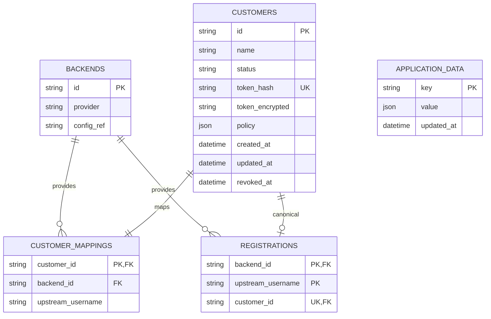

# Customer identity, database and configuration authority

Production uses SQLite revision `0003`. Marzban and Keyholder each own different
facts; customer management does not require editing source code.

`alembic_version` stores the schema revision. `backends.config_ref` references
server configuration, never panel credentials. `customer_mappings` connects a
public customer identity to its upstream account. `registrations` enforces one
canonical identity per backend/username with a composite primary key and a unique
customer ID. Historical mappings can remain without being canonical registrations.
`application_data` retains dormant legacy data and migration rollback archives;
it is not a second plan database.

Tokens contain 256 random bits. Public authentication uses the unique SHA-256 hash.
`token_encrypted` stores authenticated Fernet ciphertext so an authorized operator
can retrieve the original URL. The encryption key is a server-only environment
secret outside SQLite. Decryption also checks the token hash. There is no token TTL.
Back up both the database and key; a database-only backup cannot recover URLs.
Database plus key compromise exposes subscription credentials, so recovery sets
are root-only and must be encrypted before any future off-host transfer.

## One registration, one URL

`POST /admin/customers` atomically registers or retrieves the existing identity.
Repeating it returns the same ID and token rather than creating another customer.
Concurrent requests are guarded by the database constraint. The established 201
response is retained even when retrieving an existing registration. Repeated
registration does not rename a customer, alter its policy or reactivate it.

`GET /admin/customers/{id}/subscription`, or `keyholder link USER`, retrieves the
same URL. Listing contains no token. A legacy row without ciphertext returns 409;
a missing/wrong vault key returns 503. Neither failure silently creates a new URL.
An explicit `rotate-token` changes the token while retaining the customer ID.
Remapping changes the upstream account while retaining the customer URL; mapping
to an already registered account returns 409.

The owner approved rotation on October 11, 2026. The two current Marzban users have
two canonical, retrievable subscriptions. Two duplicate Keyholder rows were revoked
and retained as history. Earlier URLs were intentionally invalidated. The external
removal of `test-xhttp` was confirmed by the owner; it was not recreated.
Ordinary future upgrades must preserve the current identities and hashes.

## Single sources of truth

| Fact | Authority |
|---|---|
| User status, quota, expiry, usage, proxy credentials, selected inbounds | Marzban |
| Stable public customer ID/token, mapping, local delivery pause/revocation | Keyholder |
| Active protocol definitions and host templates | Marzban/Xray |
| TLS and external HTTP routing | Nginx and Cloudflare |

Production sets `KEYHOLDER_PROFILE_SOURCE=marzban`. Every fetch follows the user's
current supported Marzban links; selecting or deselecting an inbound takes effect
on the next subscription refresh without editing Keyholder policies or code.
`KEYHOLDER_ALLOWED_CDN_HOSTS` restricts CDN delivery to Titan. Legacy `policy` mode
and five-profile defaults remain available for compatibility, but stored customer
policies do not gate profiles in Marzban-authority mode.

Normalization is still a tested compatibility/security boundary. It does not
blindly forward unsupported protocols, unsafe TLS or plaintext direct IPv4.
Supporting a new protocol family requires a renderer; creating or editing a user
never does. XHTTP `extra` is removed only in the established XHTTP transformation.

Links do not expire on a timer. Delivery can stop after explicit rotation/revocation,
local disablement, upstream account limits/expiry, or operational failure. Stable
links depend on retaining the domain, path, database, vault key and backups; no
software can promise perpetual availability independently of those assets.
