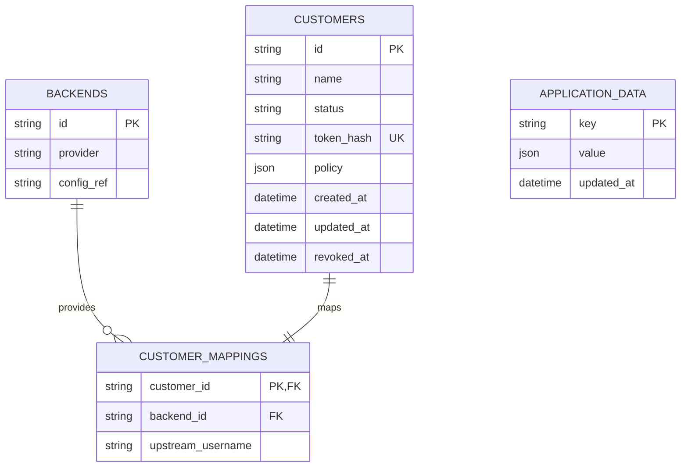

# Customer identity and configuration authority

## Confirmed current production schema (revision 0002)

`alembic_version` stores the migration revision. `backends.config_ref` references
server-side configuration rather than credentials. Customer tokens are random
256-bit bearer credentials; only SHA-256 hashes are stored. `policy` currently
contains the allowed profile families. Application data retains legacy/rollback
archives, not live user plans. Passwords, quota, expiry, protocol credentials and
inbound selections belong to Marzban's separate database, not Keyholder.

A mapping has one customer, but the current schema does not enforce uniqueness
of `(backend_id, upstream_username)`. A read-only aggregate check found four
customers and two duplicated upstream groups. Existing links must remain valid;
adding a uniqueness constraint directly would fail or force deletion.

## Link semantics and current limitation

`POST /admin/customers` creates a new identity every time; it is not a lookup.
The CLI prevents repeated creation by preflight, but direct API calls do not.
This explains different IDs/URLs after repeating creation. `/s/{token}` does not
expire on a timer. Disable/revoke, explicit token rotation, Marzban inactive status,
quota/expiry or missing upstream can prevent delivery. Maintaining availability
also requires preserving the public domain, TLS, database and recovery backups.
No implementation can promise eternal availability independent of those assets.

Hashes cannot recover existing original tokens. Storing them as hashes protects
links if the database leaks, but makes redisplaying a lost URL impossible. A new
retrieval feature cannot retroactively reverse hashes. Never silently rotate links
or delete duplicate customers to make the database easier to migrate.

## Revised authority model (local implementation; not deployed yet)

`KEYHOLDER_PROFILE_SOURCE=marzban` makes subscription requests follow the supported
configurations returned for the current Marzban user. Enabling or disabling an
inbound in Marzban takes effect on the next fetch, without changing customer
policies, IDs, tokens or source code. Existing `policy` mode remains the deployment
default for backwards compatibility until the revised release is validated.
The setting applies to all customers, including old duplicate links.

Marzban is authoritative for user status, quotas, expiry and protocol/inbound
selection. Keyholder is authoritative for permanent public identity, mapping and
revocation. Normalization remains a compatibility/security boundary; unsupported
protocols are not blindly passed through. Adding support for a genuinely new
protocol requires a tested renderer; creating/editing individual users does not.

## Pending identity decision and migration design

Recommended: one canonical registration per `(backend_id, upstream_username)`,
with existing duplicate customer rows retained as compatibility aliases. Register
or get should atomically return that canonical identity, never mint a fresh token
on a repeated call. An explicit rotate operation remains separate.

Use a separate encrypted token vault for retrievable links, with authenticated
encryption from a maintained library and a server-only key outside SQLite. Back up
both database and encryption key; prohibit plaintext exports/logging. New issuance
stores hash plus encrypted token. Existing links remain valid; their vault entries
can be populated only by supplying the original token once with hash verification,
or by a separately approved rotation. An unrecoverable legacy URL should produce
an explicit error rather than another customer or implicit rotation.

Do not implement custom encryption, derive tokens from usernames/IDs, expose raw
Marzban links as permanent public URLs, or discard compatibility aliases. Atomic
registration needs a database uniqueness constraint on the canonical registry,
not just a CLI preflight. Concurrent registration, restart/backup recovery, key
loss, alias preservation and secret-free logging require regression tests.

The vault/registry requires a new migration and image; neither is deployed yet.
A fresh consistent snapshot, clone migration rehearsal, preserved token-hash and
mapping checks, isolated API tests and explicit image rollback must precede it.

## Rollout record

On 2026-10-11, the owner authorized granting the two previously validated Titan CDN
families to all existing subscriptions. Two remaining customers gained the families;
the two test1 mappings already had them. All four IDs, statuses, token hashes and
mappings compared unchanged. A consistent SQLite snapshot and prior policies are
root-only under `/var/backups/keyholder-policy-rollout/<timestamp>`.
