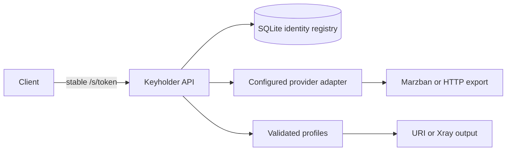

# Architecture and code map

The panel owns accounts, quota/expiry and inbound selections. Keyholder owns the
customer identity, stable bearer URL, mapping and local delivery status. It reads
upstream selections on each fetch; it stores no duplicate panel quotas or inbounds.
Changing the panel selection does not require per-user source changes.

| Path | Responsibility |
|---|---|
| `src/keyholder/main.py` | Factory, lifecycle, pooled HTTP and secret-safe middleware |
| `src/keyholder/api/` | Public subscriptions and authenticated management |
| `src/keyholder/backends/` | Provider configurations, factories and read-only adapters |
| `src/keyholder/rendering/` | Strict normalization and URI/Xray rendering |
| `src/keyholder/profile_types.py` | Authoritative family names and compatible defaults |
| `src/keyholder/{config,schemas,policies}.py` | Environment, API types and policy handling |
| `src/keyholder/{models,db,vault,security}.py` | Persistence and bearer-token protection |
| `src/keyholder/cli.py` | Installable SSH command frontend |
| `scripts/admin/` | Privileged host dispatcher and container worker |
| `migrations/` | Explicit, ordered Alembic upgrades |
| `tests/contracts/` | Frozen synthetic compatibility fixtures |
| `deploy/` | Optional ingress/networking examples; generated secrets are not templates |
| `docs/` | Public documentation; personal deployment material belongs in `.private/` |

## Database

| Table | Stores |
|---|---|
| `customers` | ID, private name, nullable unique Telegram/phone, local status, token hash/encrypted token, legacy policy and timestamps |
| `customer_mappings` | Customer → backend ID and upstream account reference |
| `registrations` | Unique canonical customer per backend/account namespace |
| `backends` | Nonsecret provider/config-reference metadata |
| `application_data` | Dormant historical data and migration rollback archives |
| `alembic_version` | Schema revision |

Tokens use a high-entropy random value; hashes identify incoming requests, while a
server-only Fernet key enables authenticated retrieval. Token expiry is not scheduled.
Explicit rotation/revocation and domain/database/key loss affect availability.
Customer contact fields are plaintext administrator metadata in the private
database and backups. They never appear in subscriptions or provider mappings.

## Boundaries

The API never provisions panel users or changes proxy services. CLI management is
explicit. Read transactions close before network awaits. No cache delays panel
changes. Health checks cover DB connectivity only. Admin authentication is one
bearer key; multi-operator roles are not implemented. Local revocation does not
invalidate previously downloaded proxy credentials; enforce access in the panel.

Supported deployment: SQLite, one API worker, bounded in-memory rate limiting.
SQLAlchemy does not imply tested support for other databases. Multiple replicas,
shared rate limits, failover, billing and background reconciliation are out of scope.
